# Microsoft Copilot for Builders — Deep Analysis

## Copilot Code · Copilot Studio · GitHub Copilot App

> **Status of information:** as of **17 November 2026**, the first day of Microsoft Ignite 2026. Announcements from GitHub Universe 2026 (28 Oct) and Microsoft Build 2026 (2–3 Jun) are included. Ignite 2026 announcements were **not yet published** when this was written.
>
> **Legend used throughout:**
> - ✅ **verified**: read in an official source
> - 🟡 **partial**: secondary source or partially read
> - 🔶 **inferred**: our own analysis
> - ❓ **unconfirmed**: no source found
>
> Previews are marked **(Preview)**. Prices are USD list prices and exclude enterprise agreements and discounts.

---

## Table of contents

1. [Executive summary](#1-executive-summary)
2. [Rating card](#2-rating-card)
3. [The landscape at a glance](#3-the-landscape-at-a-glance)
4. [Product deep dives](#4-product-deep-dives)
5. [The underlying GitHub Copilot harness](#5-the-underlying-github-copilot-harness)
6. [Copilot Managed Runtime and other runtimes](#6-copilot-managed-runtime-and-the-other-runtimes)
7. [Pricing and billing model](#7-pricing-and-billing-model)
8. [CI/CD, security and policy governance](#8-cicd-security-and-policy-governance)
9. [Monitoring and observability](#9-monitoring-and-observability)
10. [Connectors and extensibility](#10-connectors-and-extensibility)
11. [Integration with GitHub Enterprise](#11-integration-with-github-enterprise-source-code-and-cicd)
12. [Agent 365, Microsoft Foundry and third-party data platforms](#12-integration-with-agent-365-microsoft-foundry-and-third-party-data-platforms)
13. [Identity, data residency and compliance](#13-identity-data-residency-and-compliance)
14. [Model choice](#14-model-choice)
15. [Pros and cons](#15-pros-and-cons)
16. [Personas and use-case positioning](#16-personas-and-use-case-positioning)
17. [Decision tree](#17-decision-tree)
18. [Better-together reference architecture](#18-better-together-reference-architecture)
19. [FinOps: worked cost scenarios](#19-finops-worked-cost-scenarios)
20. [Adoption roadmap and recommendations](#20-adoption-roadmap-and-recommendations)
21. [Risks, limitations and open questions](#21-risks-limitations-and-open-questions)
22. [What to watch](#22-what-to-watch-ignite-2026-and-beyond)
23. [Glossary](#23-glossary)
24. [Sources](#24-sources)

---

## 1. Executive summary

Microsoft now offers **three different "builder" experiences** with the Copilot name. They overlap on the surface but target different people, run on different runtimes and bill through **three different meters**.

| | **Copilot Code** | **Copilot Studio** | **GitHub Copilot App** |
|---|---|---|---|
| One-liner | Lets anyone in M365 describe what they want and get working code, apps and automations | Low-code and pro-code **agent** platform for business processes and customer-facing agents | Agent-first desktop app for **software engineers**, from issue to merged PR |
| Home | Microsoft Copilot app → *Code* tab, next to Chat and Cowork | copilotstudio.microsoft.com, Power Platform, VS Code extension | Desktop app (Windows/macOS/Linux), plus CLI, VS Code, github.com |
| Status | **Frontier preview** (announced Oct 2026), no GA date ✅ | **GA**, mature since 2023; new harnesses in 2026 ✅ | **GA** (17 Jun 2026); major update at Universe (28 Oct 2026) ✅ |
| Output | Apps, scripts, prototypes, documents; can publish to **Copilot Managed Runtime** | **Agents**, published to Teams, M365 Copilot, web, MCP/A2A endpoints | **Pull requests** and code in GitHub repos |
| Billing | M365 Copilot licence + **Copilot Credits** (spending policy) | **Copilot Credits** (packs, PAYG, P3) | GitHub plan + **GitHub AI Credits** (+ sandbox / Actions compute) |
| Governance plane | M365 admin center, Purview, Cost Management | Power Platform admin center, Agent 365, Purview, Defender | GitHub Enterprise **AI Controls**, audit log, rulesets |

### Key findings

1. **There is one shared harness, sold in several places.** The engine behind the GitHub Copilot CLI is exposed through the **Copilot SDK**. GitHub calls it the "multi-model harness". It powers the GitHub Copilot App, cloud agent, CLI and SDK apps ✅.
   - The SDK v2 is being rebranded **Microsoft Copilot SDK**, with Entra sign-in ✅.
   - Copilot Studio's *Microsoft Copilot harness* was formerly called the *GitHub Copilot harness* ✅.
   - Copilot Code very likely embeds the same harness 🔶, but Microsoft hasn't documented this.
   - So the **agent loop is converging, but the commercial wrappers aren't**.
2. **"Copilot Managed Runtime" hosts apps, not agents.** It is the in-tenant M365 hosting service (Preview since 25 Sep 2026) for TypeScript/JavaScript apps built by Copilot Code, Cowork, Copilot Studio or the `ms` CLI ✅.
   - The managed runtimes for **agents** are:
     - Copilot Studio's SaaS runtime
     - **Foundry hosted agents**
     - **GitHub cloud sandboxes** and Actions
3. **The products serve different personas:**
   - **GitHub Copilot App** is the clear choice for professional engineering teams and the most mature for SDLC governance: rulesets, CodeQL, signed commits, agent-aware audit logs.
   - **Copilot Studio** is the clear choice for business agents with deep M365 and Power Platform connectivity and the richest governance: DLP, Agent 365, Entra Agent ID, Defender real-time protection.
   - **Copilot Code** democratises coding for knowledge workers and "citizen developers". It is promising but still **preview-grade**:
     - no published rate card
     - partial documentation (the RAI card returns 404)
     - weak folder isolation between projects
4. **Billing has become fully usage-based and fragmented.** All three now meter consumption in "credits" worth **$0.01 each**, but they are **not interchangeable**:
   - **Copilot Credits**, under Microsoft/Azure billing, cover Studio and Code.
   - **GitHub AI Credits**, under GitHub billing, cover the GitHub App.
   - FinOps teams need **two budgets, two policy planes and two telemetry pipelines**.
5. **Agent 365 + Entra Agent ID + Purview + Defender form the cross-cutting control plane** for Microsoft-side agents.
   - GitHub's agents are governed by **GitHub Enterprise AI Controls** instead.
   - We found **no evidence** that GitHub cloud-agent sessions register in Agent 365 or use Entra Agent IDs ❓. This is the biggest governance seam.
6. **Third-party data platforms are reached mainly through MCP:**
   - **Databricks** Genie and managed MCP (Preview), with Unity Catalog permissions enforced.
   - **Snowflake** Cortex Agents: GA in Teams/M365 Copilot; managed MCP in Studio needs manual OAuth.
   - **Fabric data agents**: GA in Studio.
   - Copilot Studio is the most integrated hub. The GitHub App and Copilot Code reach these platforms via MCP servers.

### Recommendation in one paragraph

Use the **GitHub Copilot App** (with GitHub Enterprise and the cloud agent) as the **engineering** platform. Use **Copilot Studio** (with Foundry for pro-code and Agent 365 for control) as the **business-agent** platform. Run **Copilot Code** as a **governed pilot** for knowledge workers and makers, using Copilot Managed Runtime as the only sanctioned way to put the apps it builds in front of users. Before scaling Copilot Code, put **spending policies, budgets and audit** in place. Unify telemetry with OpenTelemetry → Azure Monitor / Sentinel and the GitHub audit-log stream.

---

## 2. Rating card

Scores run from 1 to 5, where 5 is best in class. The ratings are our analysis 🔶, based on the verified facts in this document, as of Nov 2026.

| Criterion | Weight | Copilot Code | Copilot Studio | GitHub Copilot App |
|---|:---:|:---:|:---:|:---:|
| Product maturity (GA, SLA, docs) | 10% | ⭐⭐ (2) | ⭐⭐⭐⭐⭐ (5) | ⭐⭐⭐⭐ (4) |
| Professional software-engineering depth | 10% | ⭐⭐⭐ (3) | ⭐⭐ (2) | ⭐⭐⭐⭐⭐ (5) |
| Accessibility for non-developers | 10% | ⭐⭐⭐⭐⭐ (5) | ⭐⭐⭐⭐ (4) | ⭐⭐ (2) |
| Security and policy governance | 15% | ⭐⭐⭐ (3) | ⭐⭐⭐⭐⭐ (5) | ⭐⭐⭐⭐ (4) |
| CI/CD and GitHub Enterprise integration | 10% | ⭐⭐⭐ (3) | ⭐⭐⭐ (3) | ⭐⭐⭐⭐⭐ (5) |
| M365 / business-data grounding | 10% | ⭐⭐⭐⭐ (4) | ⭐⭐⭐⭐⭐ (5) | ⭐⭐ (2) |
| Connectors and third-party data platforms | 10% | ⭐⭐⭐ (3) | ⭐⭐⭐⭐⭐ (5) | ⭐⭐⭐ (3) |
| Monitoring and observability | 10% | ⭐⭐ (2) | ⭐⭐⭐⭐ (4) | ⭐⭐⭐⭐ (4) |
| Cost transparency and predictability | 10% | ⭐⭐ (2) | ⭐⭐⭐ (3) | ⭐⭐⭐ (3) |
| Model choice and extensibility (MCP, skills, BYOK) | 5% | ⭐⭐⭐⭐ (4) | ⭐⭐⭐⭐ (4) | ⭐⭐⭐⭐⭐ (5) |
| **Weighted score (out of 5)** | 100% | **3.05** | **4.05** | **3.65** |

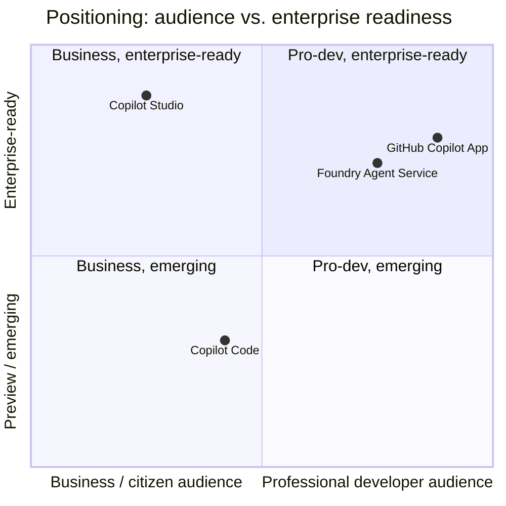

### How to read the scores

- **Copilot Studio** scores highest overall. This reflects its maturity and governance depth, not suitability for every use case: it isn't an IDE.
- **GitHub Copilot App** loses points only on business-data grounding and accessibility for non-developers. For engineering teams it is effectively **5/5**.
- **Copilot Code** is held back by its preview status. Its accessibility (5/5) and M365 grounding are real strengths, and the score should rise quickly as it moves to GA.

---

## 3. The landscape at a glance

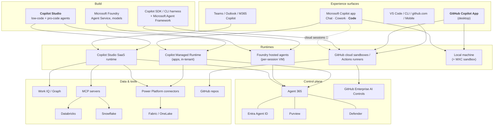

> **Note on the diagram:** Copilot Code's cloud sessions run in a "secure, isolated environment" ✅. Whether that environment is GitHub's cloud-sandbox infrastructure is **not documented** 🔶. The dotted line reflects this.

---

## 4. Product deep dives

### 4.1 Copilot Code (Microsoft Copilot app → *Code*)

| Aspect | Detail | Status |
|---|---|---|
| What it is | A **Code** tab in the Microsoft Copilot app, next to Chat and Cowork. Users describe what they want, and Copilot writes, runs and previews code, apps, scripts and data analyses. | ✅ |
| Availability | **Frontier program** preview. The desktop app needs the **Beta channel** (policy `TargetChannel{C50565E9…}=beta`, deployable via Intune). Windows x64/Arm and macOS desktop, plus web (cloud only). No mobile app. No GA date. | ✅ |
| Accounts | Work (Entra ID) and personal (MSA, with a supported consumer plan ❓). | ✅ / ❓ |
| Execution | **Cloud** (default) or **local** in a protected folder sandbox. Local is **off by default for organisations**. It prompts before shell, network, MCP and access outside the folder, with an "Always allow" option. | ✅ |
| Modes | Interactive · Plan · Automatic (labelled *autopilot* in the product). | ✅ |
| Grounding | **Work IQ** (mail, files, meetings, chats), M365 plugins, web search, image generation. | ✅ |
| Extensibility | MCP servers, extensions and skills; Cowork plugins. | ✅ |
| GitHub | Clone, branch, commit, draft PRs, *My Work*. The GitHub connection is **off by default**; admins can allow GitHub.com, GHE, both or none. | ✅ |
| Publishing | **Copilot Managed Runtime**: governed, in-tenant hosting with Entra sign-in. | ✅ |
| Admin | Audit of generated code, commands run and files read/written. Spending policies and budgets in Cost Management. | ✅ |
| Seen in the product but not yet documented | Git worktrees per session, browser/editor/terminal canvases, scheduled workflows, cross-session orchestration, Power BI tools. | 🔶 |

**Typical flow**

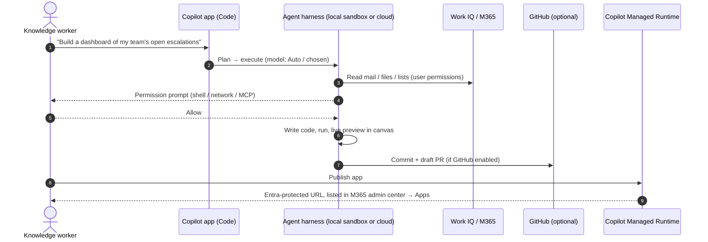

### 4.2 Microsoft Copilot Studio

| Aspect | Detail | Status |
|---|---|---|
| What it is | SaaS platform for building, testing, publishing and governing **agents**: conversational, autonomous, computer-using and voice. Covers low-code (designer) and pro-code (VS Code extension, GA Jan 2026). | ✅ |
| Harnesses | **Standard** (classic orchestration, billed per feature only after publishing). **Microsoft Copilot harness**, formerly the "GitHub Copilot harness" (GA Aug–Sep 2026): recursive planner, skills, memory, file sandbox, MCP, Work IQ, A2A; fully usage-based, so authoring and testing also consume credits. **Customer Conversation harness** (Preview, Oct 2026). | ✅ |
| 2026 milestones | Evaluations GA (Mar); Evaluations REST API for CI/CD (Apr); A2A GA (Apr); computer use GA on Windows 365 for Agents (May); skills and memory (Jun); **Entra Agent ID auto-created for every agent** (Jul); App Insights export at environment level (Jul); MCP certification (Jul); Fabric IQ (Aug); Agent 365 onboarding (Aug); Work IQ GA (Oct); **Copilot Studio MCP server for GitHub Copilot, Claude Code and Codex** (Oct); **publish agents as MCP or A2A endpoints** (Oct); persistent agents (Oct); connected Foundry / M365 Agents SDK agents (Oct); spending policies in the M365 admin center (Oct, Preview). | ✅ |
| Channels | Teams, M365 Copilot, web, mobile, telephony/voice, custom apps, MCP and A2A endpoints. | ✅ |
| Apps | *Apps* (Preview) are built in Studio and run on Copilot Managed Runtime. | ✅ |
| ALM | Dataverse solutions, Dataverse Git integration, Power Platform Pipelines, Power Platform Build Tools / GitHub Actions, Copilot ALM Starter. | ✅ |

**Agent anatomy**

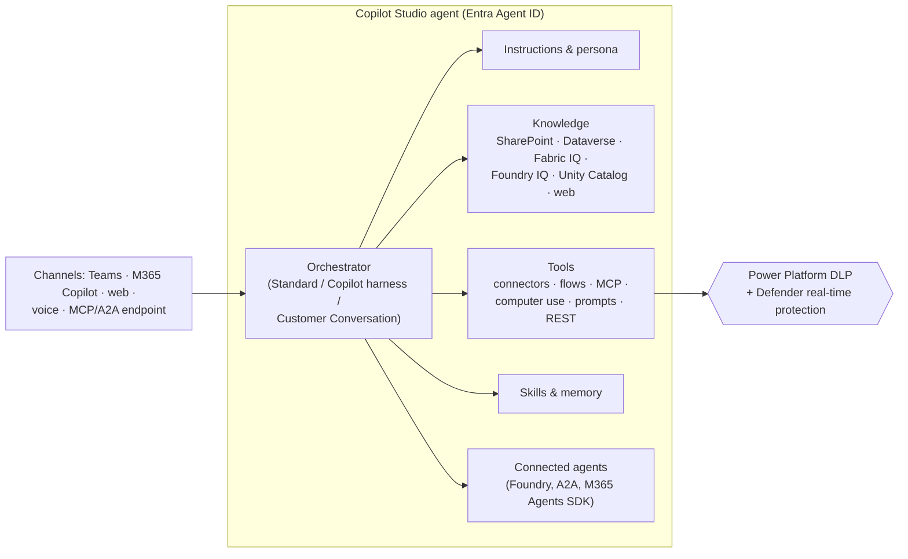

### 4.3 GitHub Copilot App

| Aspect | Detail | Status |
|---|---|---|
| What it is | An **agent-first desktop app** (macOS, Windows including WSL2, Linux) built on the **Copilot CLI harness**. It orchestrates parallel agent sessions from issue to merge. | ✅ |
| Timeline | Preview at Build (2 Jun 2026) → **GA 17 Jun 2026** → Universe update (28 Oct 2026). The update added Copilot **Projects** (multi-repo), computer use, Slack and Figma context, **Copilot Fusion** routing tiers (Standard/High/Max/Fast) and session continuity across the app, VS Code, CLI and web. | ✅ |
| Sessions | One **git worktree per session**. Each session runs **local**, in a **local sandbox** (MXC) or in a **cloud sandbox**. | ✅ |
| Modes and features | Interactive / Plan / Autopilot. BYOK. *My Work* inbox. **Agent Merge** (automated PR lifecycle). Canvases. **Automations** (cron/event). `/chronicle`. Custom agents (`.github/agents/*.agent.md`). Skills (`SKILL.md`). | ✅ |
| Repo config | `.github/github-app.yml` (legacy `copilot-desktop.yml`), with keys: `instructions`, `scripts` (`session.create`, `session.archive`), `server_ready_pattern`, `auto_open_in_browser`, `automation.auto_issue_session`, `automation.remote_control`. Scripts receive `GH_TOKEN`. Users must re-accept the configuration after it changes. | ✅ |
| Family | **Cloud agent** (issue → draft PR on `copilot/*` branches, runs on Actions or cloud sandboxes). **Copilot code review** (Lite/Balanced/Max, plus `/security-review`). **Copilot SDK** (GA: Node, Python, Go, .NET, Rust, Java). **Agent HQ** third-party agents (Claude, Codex; Preview). | ✅ |
| GHES | The app supports GHES repositories (reported GA 13–16 Nov 2026, **no cloud sessions**) 🟡. Copilot itself is licensed from GitHub.com / GHE.com. | 🟡 |

**Issue-to-merge flow**

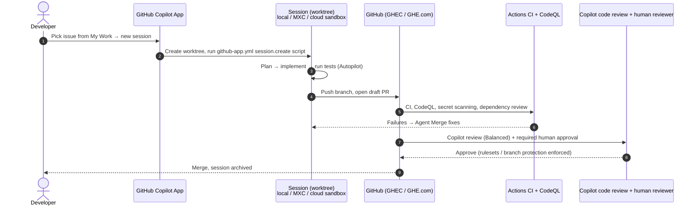

---

## 5. The underlying GitHub Copilot harness

### 5.1 What the "harness" is

The **harness** is the agent runtime that owns the full agent loop, as distinct from the model:

- turn loop and tool routing, including parallel tool calls
- permissions and hooks (`preToolUse` / `postToolUse`)
- MCP client, skills, plugins, custom agents, subagents and fleet mode
- steering and queueing, autopilot completion nudges
- context compaction into checkpoints, and session persistence (`events.jsonl`)

The **Copilot SDK** "exposes the same engine behind Copilot CLI" ✅. The SDK is a thin client over JSON-RPC (v1) or in-process FFI to a native **Rust runtime** (v2) ✅.

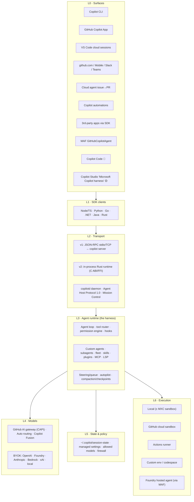

### 5.2 Which products use it?

| Surface | Uses the harness? | Evidence |
|---|---|---|
| Copilot CLI, Copilot SDK apps | ✅ Yes, it *is* the harness host | SDK README |
| **GitHub Copilot App** | ✅ Yes. It is built on the CLI harness; local sessions use MXC and cloud sessions use cloud sandboxes | GitHub docs |
| Copilot cloud agent and automations | ✅ / 🔶 Yes, described as the "multi-model harness" | Universe 2026 blog |
| VS Code | 🟡 Cloud sessions yes; for local agent mode it's unclear | GitHub docs |
| **Copilot Studio**: *Microsoft Copilot harness* | 🟡 It was named "GitHub Copilot harness" before being renamed, so the lineage is verified. Its internal runtime isn't documented. | Learn |
| **Copilot Code** | 🔶 Inferred. Its permission model, local/cloud split, skills, MCP and worktrees mirror the CLI/SDK, and SDK v2 adds Entra sign-in. Not officially confirmed. | Copilot Code overview |
| Microsoft Agent Framework | ✅ `GitHubCopilotAgent` / `AsAIAgent()` 1.0 wraps the harness as a MAF agent, which can be hosted on Foundry | MAF Build 2026 blog |

### 5.3 Agent loop

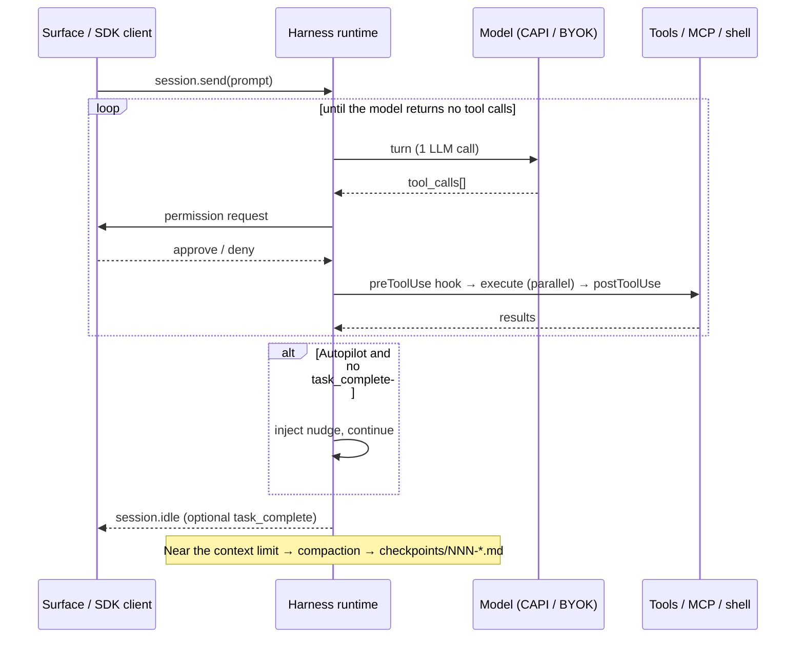

### 5.4 Why it matters (analysis 🔶)

- **Skills, custom agents, MCP configurations and instructions are portable.** A `SKILL.md`, `.agent.md` or MCP server built for the GitHub App also works in the CLI and SDK. It is likely to work in Copilot Code and the Studio Copilot harness too, since they share the harness lineage. Invest in **one shared library of skills and MCP servers**.
- **One security model to learn.** All of these surfaces share the same permission prompts, hooks, sandboxing (MXC) and firewall semantics.
- **The wrappers still differ, so the bill differs too.** The same loop is billed as GitHub AI Credits (App, CLI, SDK), as Copilot Credits (Studio Copilot harness, Code), or as Azure consumption (Foundry-hosted SDK agents).
- **Two harnesses co-exist at Microsoft.** The **Copilot harness** is coding-centric. The **Microsoft Agent Framework Agent Harness** is general-purpose, works with any model and is hosted on Azure. MAF's Copilot SDK adapter bridges the two.

---

## 6. Copilot Managed Runtime and the other runtimes

### 6.1 Copilot Managed Runtime (CMR)

**What it is.** A Microsoft-hosted runtime for **apps**: TypeScript/JavaScript single-page apps created by people and agents with Copilot. The apps run **inside the customer's M365 tenant boundary**. CMR has been in **public preview since 25 Sep 2026** ✅.

> ⚠️ The name suggests an *agent* runtime. It isn't one: CMR does **not** host agent loops.

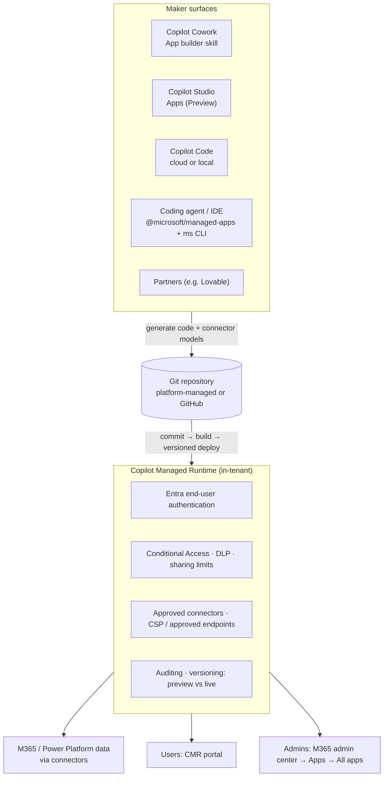

| Dimension | Detail |
|---|---|
| Sources | Cowork, Copilot Studio, Copilot Code, SDK + `ms` CLI, third-party partners ✅ |
| Source of truth | A Git repository, either platform-managed or external GitHub ✅. `ms.config.json` is owned by the CLI ✅ |
| Security | Entra auth, Conditional Access, DLP, sharing limits, approved connectors and endpoints (CSP), auditing ✅ |
| Lifecycle | Commit → build → deploy as a new version. New versions can be previewed while the current one stays live ✅ |
| Admin | Inventory in M365 admin center → *Apps* ✅ |
| Billing | A **separate Managed Runtime spending policy** (Copilot Credits) for running apps ✅. No public rate card ❓ |

**Positioning.** CMR is Microsoft's answer to "shadow apps" built by AI. It gives every vibe-coded app identity, governance, an inventory and versioning by default. Treat it as **the only sanctioned way to deploy** Copilot Code output to other users.

### 6.2 Comparison of managed runtimes

| | GitHub **cloud sandbox** | GitHub **Actions** (cloud agent) | **Foundry hosted agents** | **Copilot Managed Runtime** | **Copilot Studio runtime** | **Copilot Code cloud** |
|---|---|---|---|---|---|---|
| Hosts | Copilot harness sessions | Cloud-agent jobs | Any containerised agent | TS/JS **apps** | Studio agents | Code sessions |
| Isolation | Isolated Linux environment per session ✅ | Ephemeral runner ✅ | **Per-session VM** ✅ | Tenant boundary + CSP ✅ | Power Platform environment ✅ | "Secure, isolated" ✅ (details ❓) |
| Network control | Firewall allowlist (Bash tool only) ✅ | Firewall + runner network ✅ | ❓ (BYO VNet for Agent Service ✅) | Approved endpoints, DLP ✅ | Connector DLP, HTTP blocking ✅ | ❓ |
| Identity | GitHub user / Copilot token ✅ | Copilot token + OIDC ✅ | **Entra agent identity** + OBO ✅ | Entra user ✅ | **Entra Agent ID** (automatic) ✅ | Entra / MSA ✅ |
| Lifecycle | Snapshot / resume ✅ | Job; setup ≤59 min ✅ | Idle 2–240 min → scale to zero; 30-day retention ✅ | Versioned deploys ✅ | Published versions, solutions ✅ | Session ❓ |
| Billing | AI credits + vCPU-s / GiB-s / GiB-month ✅ | AI credits + Actions minutes 🟡 | Azure vCPU-h / GiB-h ✅ (rate ❓) | CMR spending policy ✅ | Copilot Credits ✅ | Copilot Credits ✅ |

### 6.3 Local sandboxing (MXC)

**Microsoft eXecution Container (MXC)** is an open-source, cross-platform layer for process and filesystem containment ✅. It is not a VM.

- The harness declares a policy (readable/writable paths, network on/off) and MXC enforces it.
- It is off by default in the CLI (`/sandbox enable`) and can be **required by enterprise managed settings** ✅.
- The GitHub App sets a per-repository default and allows a per-session toggle ✅.
- 🔶 Copilot Code's "protected local environment" is very likely the same technology.

## 7. Pricing and billing model

> **Main point:** all three products now bill by consumption in credits worth **$0.01 each**. There are **two separate credit currencies**, though: Microsoft *Copilot Credits* and *GitHub AI Credits*. On top of those, there are **compute meters** for sandboxes, runtimes and Actions. Prices are list prices in USD as of Nov 2026; enterprise agreements may differ.

### 7.1 The three meters

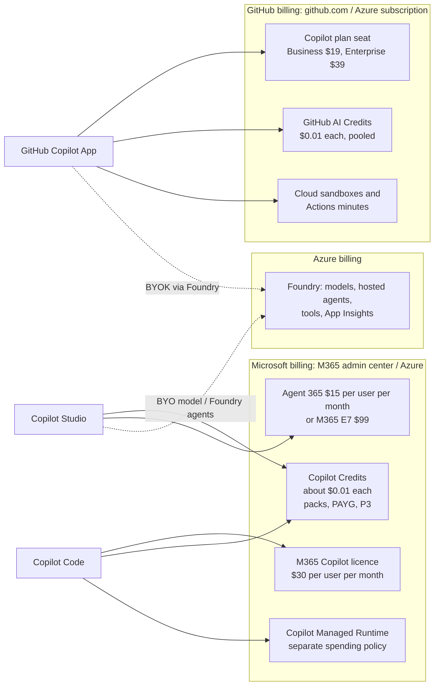

### 7.2 Copilot Code

| Item | Detail | Status |
|---|---|---|
| Entitlement | **Microsoft 365 Copilot licence** ($30/user/month) for work accounts | ✅ |
| Usage | **Copilot Credits**, which require an admin **spending policy**. PAYG is about $0.01 per credit; the **P3** pre-purchase plan also applies | ✅ |
| Rate card | **No per-task or per-token rate card has been published** for Code | ❓ |
| GitHub | **No GitHub Copilot plan is required.** Any GitHub usage (Actions, storage) is billed by GitHub separately | ✅ |
| Consumer accounts | A "supported consumer plan" is required; the plan isn't named | ❓ |
| Hosting | **Copilot Managed Runtime** has its own spending policy; no rate card has been published | 🟡 |
| Cost controls | Microsoft Cost Management: budgets per tenant, group or user; alerts; Azure chargeback; Graph API | ✅ |

### 7.3 Copilot Studio

**How you buy credits**

| Option | Price | Notes |
|---|---|---|
| Capacity pack | **$200/month for 25,000 credits** (about $0.008 per credit) | Tenant-level; allocated to environments |
| Pay-as-you-go | **$0.01 per credit** | Billed through an Azure subscription; **never blocks** |
| P3 pre-purchase (Copilot Credit Pre-Purchase Plan) | 1-year commitment in CCCU, **up to 20% discount** | Counts toward MACC. Learn's example: 15,000 CCCU for $14,100 |
| M365 Copilot licence (internal users) | Included | Covers **classic answers, agent actions and tenant-graph grounding** for licensed users |

**What each feature consumes**

| Feature | Copilot Credits |
|---|---|
| Classic answer | 1 |
| Generative answer | 2 |
| Agent action (each computer-use step counts as an action) | 5 |
| Tenant graph grounding | 10 |
| Agent flow actions | 13 per 100 actions |
| Premium model tokens (for example Claude Opus) | 10 per 1,000 tokens (cache reads are free) |
| Content processing | 8 per page |
| Voice | 10, 35 or 75 per minute, depending on tier |

> ⚠️ **Watch the premium models.** Microsoft Learn's worked example for a Claude Opus 4.7 turn costs **141–461 credits for one turn**. Agents on the *Copilot harness* also consume credits **while you author and test them**.

**What the M365 Copilot licence doesn't cover:** generative answers (except Agent Builder agents without grounding), computer use, autonomous triggers and flows, and Copilot harness usage.

**Controls:**
- Tenant capacity, then allocation per environment, then a **monthly limit per agent** with a hard stop. There is no default limit across the tenant.
- Prepaid capacity **blocks usage at 125%** of the allocation. PAYG doesn't block.

### 7.4 GitHub Copilot App

GitHub replaced premium requests (PRUs) with **GitHub AI Credits** on **1 June 2026** ✅.

| Plan | Price | Included AI credits | Notes |
|---|---|---|---|
| Free | $0 | Limited | Individuals |
| Pro | $10/month | $15 worth | Individuals |
| Pro+ | $39/month | $70 worth | Individuals |
| Max | $100/month | $200 worth | Individuals, heavy agent use |
| **Business** | **$19/user/month** | **1,900 credits per user, pooled** | Organisations |
| **Enterprise** | **$39/user/month** | **3,900 credits per user, pooled** | Enterprises |
| **"Copilot access"** (from 28 Oct 2026) | **$0** for GitHub Enterprise users, or **$10** standalone | Fully metered | Sold through account teams; **can't be mixed** with Business or Enterprise seats ✅ |

**Other meters**

| Meter | Price | Notes |
|---|---|---|
| Overage | $0.01 per AI credit | **On by default.** Budget alerts at 75%, 90% and 100% |
| Data-residency enforcement | **+10%** on consumption | GHE.com / Copilot data residency |
| Cloud sandboxes | $0.000024 per vCPU-second, $0.000003 per GiB-second, $0.005 per GiB-month of storage | Drawn from the **Actions** included allowance; **not** in the "Bundled AI credits" budget |
| Local sandboxes | Free | Run on the developer's machine |
| Cloud agent and code review | Consume Actions minutes as well as AI credits | 🟡 |
| GitHub Enterprise Cloud (platform) | About $21/user/month | General knowledge; check your agreement 🔶 |

### 7.5 Adjacent products

| Product | Price | Notes |
|---|---|---|
| **Agent 365** | **$15/user/month** (GA 1 May 2026) | Registry view is free for the AI Reader and AI Administrator roles. **Observability needs at least one Agent 365 or E7 licence, otherwise telemetry is silently dropped** ⚠️ |
| **Microsoft 365 E7** | **$99/user/month** | Includes E5, M365 Copilot, Entra Suite and Agent 365 |
| **Purview for AI and agents** | PAYG | DSPM for AI, audit, DLP for agents |
| **Foundry Agent Service** | Prompt and workflow agents: no extra charge. Hosted agents: per vCPU-hour and GiB-hour (rate ❓) | Plus tools: File Search $0.11/GB/day, Code Interpreter $0.033/session, Web Search $14 per 1,000 transactions. App Insights is billed separately. Claude models are billed via Azure Marketplace |
| **Databricks managed MCP** | No extra fee | Pay for the underlying compute (SQL warehouse, Genie, Vector Search) |

### 7.6 Comparison

| | Copilot Code | Copilot Studio | GitHub Copilot App |
|---|---|---|---|
| Seat or licence | M365 Copilot ($30) | Optional (M365 Copilot covers part of internal use) | Business $19 / Enterprise $39 / Access $0–10 |
| Usage currency | Copilot Credits | Copilot Credits | GitHub AI Credits |
| Published rate card | ❌ Not yet | ✅ Detailed | ✅ Per model, plus sandbox compute |
| Pre-purchase discount | ✅ P3 | ✅ P3 (up to 20%) | Through an enterprise agreement 🔶 |
| Hard caps | Spending policy | Per-agent limit; 125% block on prepaid | Budgets (overage on by default ⚠️) |
| Chargeback | Azure Cost Management | PPAC + Azure | Cost centres in GitHub billing |
| Predictability | 🔴 Low (preview, no rate card) | 🟡 Medium (premium models can spike) | 🟡 Medium (agent sessions vary a lot) |

---

## 8. CI/CD, security and policy governance

### 8.1 CI/CD patterns

**GitHub Copilot App and cloud agent: issue to production**

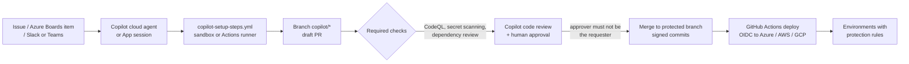

Key controls ✅:
- **`copilot-setup-steps.yml`** defines the agent environment:
  - It needs a single job named `copilot-setup-steps`.
  - Ubuntu or Windows x64 runners, with `timeout-minutes` ≤ 59.
  - Supports **ARC / self-hosted runners**, and has its own token.
- The agent can only push to `copilot/*` branches. Its PRs require **approval by someone other than the requester**.
- These **safeguards don't need a GHAS licence**: CodeQL, secret scanning and dependency checks on agent PRs.
- Custom agents and skills can live in `.github` or **`.github-private`**, protected by a push ruleset.

**Copilot Studio: ALM with GitHub Actions or Azure DevOps**

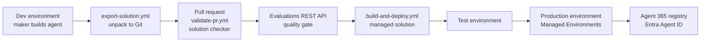

- **Copilot ALM Starter** (`microsoft/copilot-alm-starter`) provides GitHub Actions workflows (`export-solution.yml`, `build-and-deploy.yml`, `validate-pr.yml`) and Azure DevOps pipelines ✅.
- You can also use **GitHub Actions for Power Platform**, **Power Platform Pipelines** and **Dataverse Git integration** ✅.
- The **Evaluations API** can act as an automated quality gate in CI ✅.

**Copilot Code**

- The output is code. Connect a GitHub repo (if the admin allows it) to bring that code into the normal PR flow above.
- Apps published to **Copilot Managed Runtime** can use an **external GitHub repo as the source of truth** 🟡.
- There's no built-in CI/CD pipeline. **Our recommendation:** anything that goes beyond a personal prototype should move to a GitHub repo with rulesets.

### 8.2 Security and governance matrix

| Control | Copilot Code | Copilot Studio | GitHub Copilot App |
|---|---|---|---|
| Admin enablement | M365 admin center; Frontier opt-in | PPAC, environment groups, Managed Environments | Enterprise / org policies, **AI Controls** (GA 26 Feb 2026) |
| Agent identity | Inherits user 🔶 | **Entra Agent ID created automatically** (no opt-out) | GitHub App bot identity; `actor_is_agent` in the audit log |
| Data loss prevention | Purview coverage not documented ❓ | **Power Platform data policies** (Business / Non-business / Blocked; enforced everywhere, no exemptions). Blocking a connector also blocks MCP tools that depend on it | **Content exclusion** (paths, repos) |
| Threat protection | Defender for Endpoint covers local CLIs 🔶 | **Defender real-time protection** on tool calls (Preview), plus an external security-provider webhook | Defender for Endpoint **AI agent runtime protection** (Preview) for Copilot CLI, Claude Code and Codex |
| Network egress | Cloud runtime; local execution is **off by default** for orgs | Connectors, private endpoints / VNet | **Agent firewall** on by default (doesn't cover MCP servers or setup steps; can be bypassed) |
| MCP governance | Admin-controlled 🟡 | Certified connectors, data policies | **MCP allowlist registry** (Preview, supports Azure API Center) or `managed-settings.json` (GA) |
| Model governance | Model picker 🟡 | Per-agent model choice; Anthropic models need tenant opt-in | **Model policies** per enterprise or org |
| Audit | Admin audit of code, commands and files ✅ | Purview audit, transcripts, Dataverse | Audit log with **`agent_session.task`** events; streaming to a SIEM |
| Responsible AI documentation | RAI card returns 404 ❓ | Published | Published |
| Isolation weak spot | ⚠️ Folders used by one Code project are open to all Code projects without a prompt | Environment boundaries | Repo-scoped tokens; EMU personal repos aren't supported by the cloud agent |

### 8.3 The Microsoft agent security stack

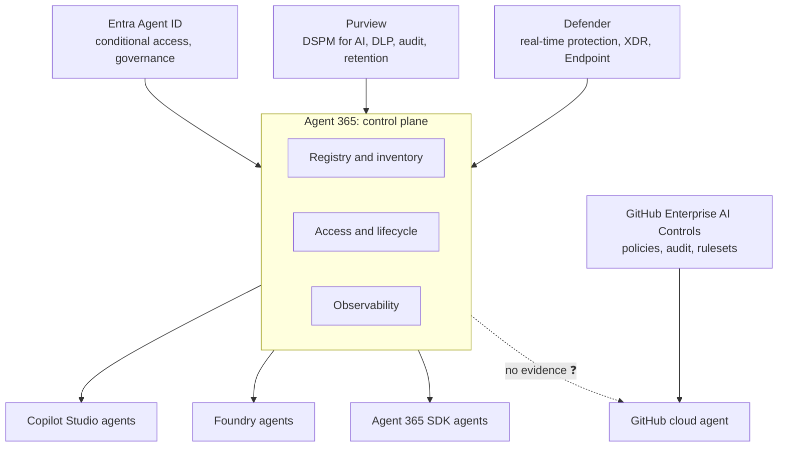

### 8.4 Minimum policy baseline (recommended 🔶)

1. **GitHub:**
   - Turn on AI Controls with a custom AI-admin role.
   - Set model and MCP allowlist policies, and content exclusion for sensitive repos.
   - Use rulesets on default branches: signed commits, required reviews, CodeQL.
   - Restrict who can assign the cloud agent.
   - Set budgets with overage limits.
2. **Copilot Studio:**
   - Use Managed Environments and a tenant-wide data policy, with MCP and HTTP connectors **Blocked** by default.
   - Turn on Defender real-time protection and set per-agent credit limits.
   - Use Agent 365 for inventory.
3. **Copilot Code:**
   - Limit it to a pilot group.
   - Keep local execution **off**.
   - Allow GitHub connections to the enterprise GitHub only.
   - Set a spending policy with low per-user budgets.
   - Forbid regulated data during the preview.
4. **Across all three:**
   - Stream audit logs (GitHub audit stream, Purview, Defender) to **Microsoft Sentinel**.
   - Review the Agent 365 inventory every month.

---

## 9. Monitoring and observability

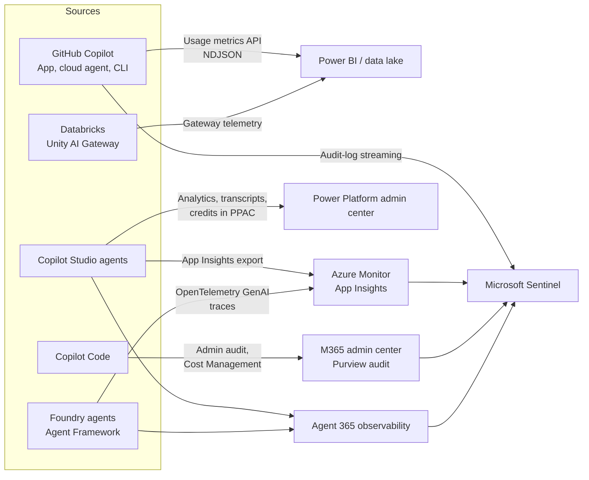

| Product | Native telemetry | Export | Maturity |
|---|---|---|---|
| **GitHub Copilot App** | **Copilot usage metrics API** (GA 27 Feb 2026, API version `2026-03-10`, NDJSON). Since 3 Nov 2026 it adds BYOK fields: `used_local_byok`, the `is_custom_enterprise_model` flag, and local providers (Ollama, Foundry Local, LM Studio). Also: session visibility, **agent session streaming** (Preview), audit log, the `/chronicle` session history | Audit-log streaming to Splunk, Azure Event Hubs, Datadog and others; API to a data lake | ✅ High |
| **Copilot Studio** | Analytics (sessions, outcomes, CSAT), transcripts, credit consumption in PPAC, Agent 365 analytics | **Application Insights** per environment, Dataverse, Purview | ✅ High |
| **Foundry** | **Tracing GA**, following OpenTelemetry GenAI semantic conventions (still marked "Development" upstream), with Microsoft/Cisco multi-agent spans; evaluations | App Insights, Azure Monitor | ✅ High |
| **Agent 365** | Fleet observability; at Ignite 2026 it was positioned as an "AI observability platform" with **financial visibility** | Sentinel, Defender | 🟡 New (needs licences) |
| **Copilot Code** | Admin audit (code, commands, files), Cost Management | Purview audit 🟡 | 🔴 Low (preview) |
| **Databricks** | Unity AI Gateway (GA 4 Aug 2026): usage, guardrails and cost telemetry | System tables | ✅ |

**KPIs to track (recommended 🔶)**

| Category | KPI | Source |
|---|---|---|
| Adoption | Weekly active users per surface; agent sessions per user | GitHub metrics API, PPAC, M365 usage |
| Engineering outcomes | Agent PR merge rate, time from issue to PR, review iterations, CodeQL findings on agent PRs | GitHub API, audit log |
| Agent quality | Resolution rate, escalation rate, CSAT, evaluation scores | Studio analytics, Foundry evaluations |
| Cost | Credits per user, per agent and per merged PR; overage spend; sandbox minutes | GitHub billing, PPAC, Cost Management |
| Risk | Blocked tool calls, DLP hits, MCP servers in use, agents without an owner | Defender, Purview, Agent 365 |

---

## 10. Connectors and extensibility

| Capability | Copilot Code | Copilot Studio | GitHub Copilot App |
|---|---|---|---|
| Pre-built connectors | Via Work IQ / M365 plugins; CMR apps can use Power Platform connectors 🟡 | ✅ **About 1,400+ Power Platform connectors** (general knowledge), plus custom connectors | ❌ (GitHub-native integrations instead) |
| MCP | ✅ MCP servers | ✅ MCP (including certified connectors), governed by data policies | ✅ **First-class**: GitHub MCP server, MCP registry and allowlist |
| A2A (agent-to-agent) | ❓ | ✅ A2A, connected agents, Foundry agents | Agent HQ (Claude, Codex and other third-party agents) |
| Skills | ✅ Skills / plugins (shared with Cowork) | ✅ Agent skills (Copilot harness) | ✅ **Agent skills** (`SKILL.md`), custom agents (`.agent.md`) |
| M365 grounding | ✅ **Work IQ** | ✅ Work IQ, SharePoint, Graph connectors | ❌ Only via MCP |
| Data grounding | Via MCP 🔶 | ✅ **Fabric IQ**, **Foundry IQ** (since 8 Jul 2026), Dataverse, Databricks Genie, Snowflake | Via MCP |
| Automation | Scripts, apps | ✅ Agent flows, Power Automate, **computer use** | GitHub Actions |
| Collaboration surfaces | Copilot app | Teams, M365 Copilot, web, WhatsApp, voice and more | **Slack, Teams, Figma, Azure Boards**, github.com |
| REST / HTTP | Generated code | HTTP node, custom connectors | Any, from code and MCP |

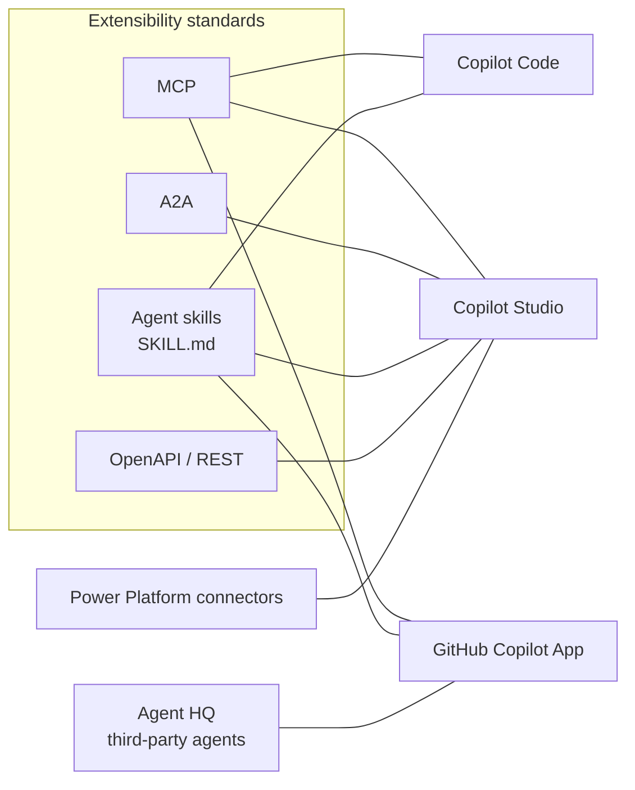

> **Main point:** **MCP and agent skills** are the common extensibility standards across all three products. Write an integration **once as an MCP server** and govern it centrally: Azure API Center for GitHub's MCP registry, and data policies for Studio. That's the most portable investment.

---

## 11. Integration with GitHub Enterprise (source code and CI/CD)

### 11.1 Hosting models

| | **GitHub Enterprise Cloud (GHEC)** | **GHE.com (with data residency)** | **GitHub Enterprise Server (GHES)** |
|---|---|---|---|
| Copilot hosting | ✅ Native | ✅ Native. Copilot data residency in **US and EU**, and all GA features work | ❌ Copilot isn't hosted on GHES. It's licensed through GitHub.com or GHE.com |
| Data-residency regions | — | EU, Australia, US, Japan | Customer-managed |
| Identity | Personal accounts or EMU | **EMU only** | Local / SAML / LDAP |
| Billing | GitHub, or an Azure subscription | Azure subscription; **+10%** for residency enforcement | Licence |
| Cloud agent and cloud sessions | ✅ | ✅ | ❌ (needs GitHub.com or GHE.com) |
| GitHub Copilot App | ✅ | ✅ | 🟡 Support for GHES repos reported as GA 13–16 Nov 2026 (secondary source), **local sessions only** |
| Copilot CLI | ✅ | ✅ | ✅ Through MCP. An air-gapped CLI technical preview exists |
| FedRAMP | — | FedRAMP Moderate models available | — |

### 11.2 Integration flow

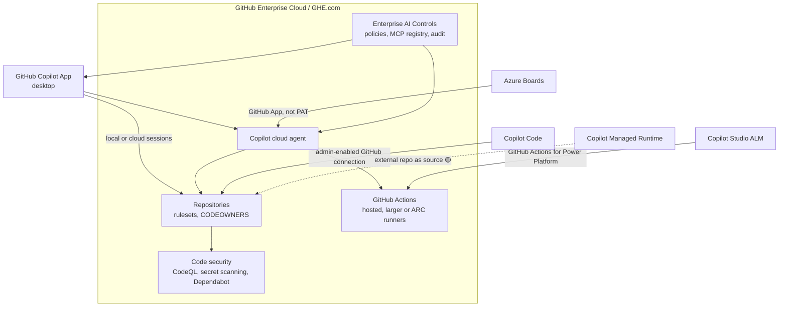

### 11.3 Notes for each product

- **GitHub Copilot App** has the deepest native integration: issues, PRs, Actions, rulesets, code review, the cloud agent and Agent HQ. Repository configuration lives in `.github/github-app.yml`.
- **Azure Boards → cloud agent:**
  - Assign a work item to Copilot. The agent opens a PR in **GitHub** (the code must be in GitHub, not Azure Repos).
  - The connection must use the **GitHub App**, not a PAT ✅.
- **Copilot Code:**
  - An admin chooses which GitHub targets are allowed: **GitHub.com, GitHub Enterprise, both or none**. The default is **off**.
  - Code can push and clone, but doesn't trigger the cloud agent on its own 🔶.
- **Copilot Studio:**
  - Solutions are exported to GitHub and deployed with GitHub Actions for Power Platform (Copilot ALM Starter).
  - GitHub is **not** where the agent runs. It's the ALM backbone.
- **Migrating from Azure DevOps:** if you plan to use the cloud agent, move repos to GitHub and keep Boards. Pipelines can stay on Azure DevOps during the transition.

---

## 12. Integration with Agent 365, Microsoft Foundry and third-party data platforms

### 12.1 Integration matrix

| | Copilot Code | Copilot Studio | GitHub Copilot App |
|---|---|---|---|
| **Agent 365** registry and governance | ❓ Not documented | ✅ **Registered automatically**, with Entra Agent ID | ❓ **No evidence** that cloud-agent sessions register. Copilot CLI / VS Code are supported tools **for building** Agent 365 agents (`gh skill add microsoft/agent365-skills`) |
| **Microsoft Foundry** | ❓ | ✅ Foundry agents as connected agents, **Foundry IQ** knowledge, BYO models | ✅ **Foundry as a BYOK model provider**. The Copilot SDK runs inside Foundry hosted agents through the **Agent Framework adapter** |
| **Fabric** | Via MCP 🔶 | ✅ **Fabric data agents GA** (around 2 Sep 2026), Fabric IQ | Via MCP |
| **Databricks** | Via MCP 🔶 | ✅ **Genie MCP** (Preview), Power Platform connector (GA) | ✅ Databricks managed MCP servers |
| **Snowflake** | Via MCP 🔶 | ✅ **Snowflake managed MCP** (manual Entra OAuth), Cortex Agents | ✅ Snowflake MCP server |

### 12.2 Agent 365

- **What it is:** the **control plane for every agent**: registry, access, lifecycle, observability and security.
  - Built on **Entra Agent ID**, **Purview** and **Defender**.
  - GA 1 May 2026, at $15/user/month or as part of M365 E7 ✅.
- **Who registers automatically:** Copilot Studio and Foundry agents.
  - Custom agents register through the **Agent 365 SDK / CLI**.
  - The "AI teammate" option (agents with their own mailbox and identity) is **Frontier-only**.
- **Licensing gotcha:** without at least one Agent 365 or E7 licence assigned, **observability data is silently dropped** ⚠️.
- **The seam:** GitHub agents are governed in GitHub, Microsoft agents in Agent 365.
  - Until Microsoft documents a bridge, **build a joined inventory**: GitHub audit log plus Agent 365 export, joined in Sentinel or Fabric 🔶.

### 12.3 Microsoft Foundry

| Capability | Detail |
|---|---|
| Foundry Agent Service | GA **16 Mar 2026**. Prompt, workflow and **hosted** agents |
| Hosted agents | Per-session VM sandbox, scale to zero, idle timeout 2–240 min, 30-day retention, **Entra agent identity**. Protocols: Responses, Invocations, Activity, **A2A** |
| Foundry Control Plane | Fleet view, **including non-Foundry agents** |
| Microsoft Agent Framework 1.0 | GA **2 Apr 2026**. Includes an **Agent Harness**, CodeAct on Hyperlight, and a **GitHub Copilot SDK adapter** |
| Models | Over 11,000 models (general knowledge 🔶), including **Claude Opus 5.5 / Haiku 5.5 GA**. Claude is billed through Azure Marketplace |
| Observability | OpenTelemetry tracing to App Insights; evaluations |

**When to use Foundry rather than Studio:**
- When you need full code control, custom orchestration or your own models.
- For multi-agent systems with A2A.
- For agents that run long or on a schedule in hosted containers.
- For **agents built on the GitHub Copilot SDK** that need enterprise hosting.

### 12.4 Third-party data platforms

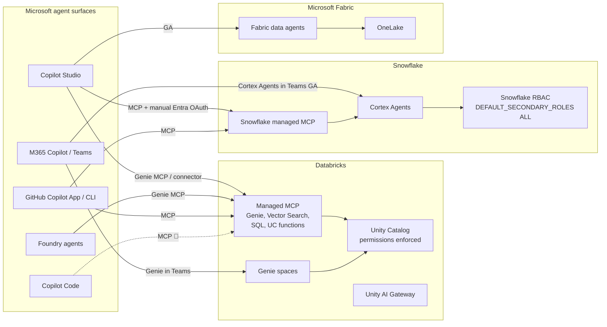

**Databricks** ✅
- Genie is available in **Teams and M365 Copilot**.
- **Genie MCP** works in Copilot Studio and Foundry (Preview since Nov 2025). The **Power Platform connector** is GA.
- **Managed MCP endpoints** exist for Genie, Vector Search, Databricks SQL and Unity Catalog functions. **Unity Catalog permissions are enforced** for the calling user. There's no extra fee.
- **Agent Bricks** (supervisor agent GA) and **Unity AI Gateway** (GA 4 Aug 2026) handle governance and telemetry on the Databricks side.

**Snowflake** ✅
- **Cortex Agents in Teams and M365 Copilot** went GA on 5 Nov 2025.
- **Snowflake managed MCP** in Copilot Studio:
  - Needs a **manual Entra OAuth** app registration (dynamic client registration isn't supported).
  - Goes through a Cortex Agent.
  - Needs `DEFAULT_SECONDARY_ROLES = ('ALL')` on the user so RBAC resolves correctly.

**Fabric** ✅
- **Fabric data agents** in Copilot Studio went GA around **2 Sep 2026**.
- Fabric IQ provides semantic grounding.

> **Recommendation 🔶:** keep governance **in the data platform**: Unity Catalog, Snowflake RBAC, OneLake security. Expose data to agents through **managed MCP endpoints with on-behalf-of identity**, rather than service accounts. That way the same rules apply whether the caller is Copilot Studio, Foundry or the GitHub App.

---

## 13. Identity, data residency and compliance

| Topic | Copilot Code | Copilot Studio | GitHub Copilot App |
|---|---|---|---|
| User identity | Entra ID (work) or MSA (consumer) | Entra ID | GitHub account / **EMU** (Entra through OIDC/SAML) |
| Agent identity | Not documented ❓ | **Entra Agent ID** (automatic) | GitHub App bot / `copilot` actor |
| Data boundary | M365 service boundary 🟡; EU Data Boundary coverage **not documented** ❓ | M365 / Power Platform geography. **Anthropic models may process data outside the geography** and aren't available in GCC | **Copilot data residency: US and EU** (GHE.com). FedRAMP Moderate models available |
| Sovereign / government clouds | ❓ | GCC available (with model restrictions) | GHE.com FedRAMP; GHES (no hosted Copilot) |
| Compliance tooling | Purview coverage not documented ❓ | **Purview DSPM for AI, DLP, audit, retention**, eDiscovery | Audit log, content exclusion, IP indemnity (with the duplicate-detection filter) |
| Training on customer data | No (enterprise) ✅ | No ✅ | No, for Business and Enterprise ✅ |

> ⚠️ For regulated workloads (FSI, public sector, health), **Copilot Code shouldn't process regulated data** until Microsoft publishes its RAI card, Purview coverage and data-boundary commitments.

---

## 14. Model choice

| | Copilot Code | Copilot Studio | GitHub Copilot App |
|---|---|---|---|
| Default | **Auto** (cloud only) | **GPT-5.5 Chat** | Auto / **Copilot Fusion** |
| OpenAI | GPT-5.6 (sol / terra / luna), GPT-5.5. GPT-6 / 6.1 appear in the app | GPT-5.x family | GPT-5.x / 6.x family |
| Anthropic | Claude **Opus 5**, 4.8, 4.7, 4.6; **Sonnet 5**, 4.6; Haiku 4.5. Claude 5.5 appears in the app | **Claude Sonnet 5, Opus 4.8** (not in GCC; may process data outside the geography) | Claude family, including Opus 5.5 |
| Microsoft | **MAI-Code-1-Flash** | — | — |
| Others | — | xAI and Mistral (experimental) | Google and others; third-party agents in Agent HQ (Claude, Codex) |
| Orchestration | Model picker | Per-agent / per-node model | **Copilot Fusion**: Standard, High, Max, Fast. *"Fusion Max is within about 2 points of Opus 5.5 Max at half the cost"* (GitHub claim) |
| Bring your own | ❌ | ✅ **Foundry models** (BYO) | ✅ **BYOK**: Anthropic, OpenAI, **Foundry**, xAI, AWS Bedrock, Google AI Studio, OpenAI-compatible endpoints, and local providers (Ollama, Foundry Local, LM Studio) |

> **Main point:** **GitHub has the widest model choice and the most control over models**: BYOK, local models and Fusion routing. **Studio** offers safe defaults, with Foundry for anything custom. **Code** has a rich model picker but **no BYOK**.

---

## 15. Pros and cons

### 15.1 Copilot Code

| ✅ Pros | ❌ Cons |
|---|---|
| Brings coding to **everyone in M365**: natural language to working app, script or prototype | **Frontier preview.** No GA date, no SLA, features change quickly |
| **Grounded in Work IQ** (mail, files, meetings), so it understands business context | **No published rate card** for Copilot Credits use, so costs are hard to predict |
| Runs in the **cloud or locally**; integrated with Chat and Cowork in one app | **Weak isolation:** folders used by one Code project are open to all Code projects without a prompt |
| **Copilot Managed Runtime** gives a sanctioned, in-tenant way to host what it builds | RAI card returns 404; Purview, EU Data Boundary and DLP coverage aren't documented |
| No GitHub licence needed; optional connection to GitHub or GHE | Limited CI/CD and observability; not a replacement for an engineering workflow |
| Rich model picker (Claude, GPT, MAI) | No BYOK; Auto only in the cloud |
| Admin controls: GitHub connection and local execution **off by default** | Risk of **shadow apps** if CMR and governance aren't in place |

### 15.2 Copilot Studio

| ✅ Pros | ❌ Cons |
|---|---|
| **Most mature agent platform**: GA, broad documentation, large ecosystem | **Complex credit model.** Premium models and the Copilot harness can drive costs up quickly (141–461 credits per Opus turn) |
| **About 1,400+ connectors**, MCP, A2A, computer use, agent flows | Authoring and testing on the Copilot harness also **consume credits** |
| **Best-in-class governance**: data policies, Managed Environments, Entra Agent ID, Defender real-time protection, Purview, Agent 365 | Low-code ALM (solutions, environments) is unfamiliar to pro developers |
| Deep **M365 grounding** (Work IQ, SharePoint, Graph) plus **Fabric IQ / Foundry IQ**; Databricks, Snowflake and Fabric data agents | No tenant-wide default per-agent credit limit; the 125% block on prepaid capacity can interrupt production |
| Publishes to Teams, M365 Copilot, web, voice and other channels | Anthropic models: not in GCC, and data may leave the geography |
| Pro-code path: VS Code extension, Foundry, Agent SDK | Not a software-engineering tool: no repo-native code review |
| ALM with GitHub Actions / Azure DevOps (Copilot ALM Starter), plus an Evaluations API | Debugging complex generative orchestration is harder than debugging code |

### 15.3 GitHub Copilot App

| ✅ Pros | ❌ Cons |
|---|---|
| **Agent-native desktop app** for engineers: parallel sessions, worktrees, from issue to merged PR | Aimed at **developers only**, with a steep curve for non-engineers |
| Built on the **multi-model harness** shared with the CLI, cloud agent and SDK | **Overage on by default.** Agent sessions and cloud sandboxes can surprise FinOps |
| **SDLC-grade governance**: rulesets, CodeQL, secret scanning, signed commits, agent-aware audit log, AI Controls | **Separate governance plane** from Microsoft (no evidence of Agent 365 / Entra Agent ID integration) |
| **Widest model choice**: Fusion, BYOK, local models; Agent HQ with Claude and Codex | Firewall doesn't cover MCP servers or setup steps, and can be bypassed |
| Cloud and **local sandboxes** (local sandboxes are free) | GHES: no hosted Copilot and no cloud sessions |
| **Usage metrics API**, session streaming, audit streaming | Limited M365 business-data grounding (only through MCP) |
| Data residency (US/EU) and FedRAMP Moderate on GHE.com | The cloud agent isn't available in EMU personal repos; Azure Boards integration needs repos on GitHub |

---

## 16. Personas and use-case positioning

### 16.1 Persona map

| Persona | Primary tool | Secondary | Why |
|---|---|---|---|
| **Knowledge worker** (analyst, PM, sales, HR) | **Copilot Code** (pilot) | M365 Copilot Chat / Cowork, Agent Builder | Build personal tools, reports and prototypes in natural language, grounded in their own work data |
| **Citizen developer / maker** | **Copilot Studio** | Copilot Code → CMR | Governed agents with connectors and flows; Code for quick app prototypes |
| **Professional developer** | **GitHub Copilot App** | VS Code, CLI, cloud agent | Repo-native, PR-centric, multi-model, parallel agents |
| **Platform / DevOps engineer** | **GitHub Copilot App + Actions** | Foundry hosted agents | `copilot-setup-steps`, runners, rulesets, SDK for internal platforms |
| **AI / agent engineer** | **Foundry + Agent Framework** | GitHub Copilot SDK, Copilot Studio (pro-code) | Custom orchestration, A2A, hosted agents, evaluations |
| **Data engineer / analyst** | **Copilot Studio** (Fabric / Databricks / Snowflake agents) | GitHub App for pipeline code | Governed data access through MCP, with platform RBAC enforced |
| **Security / compliance officer** | **Agent 365 + Purview + Defender** | GitHub AI Controls | Central inventory, DLP, threat protection, audit |
| **IT admin / FinOps** | **M365 / PPAC / GitHub billing** | Azure Cost Management | Spending policies, credit allocation, budgets, chargeback |
| **CIO / CTO** | This decision framework | — | Portfolio clarity: **Engineering = GitHub, Business agents = Studio, Democratised building = Code (pilot)** |

### 16.2 Use-case matrix

Legend: ✅ best fit · ⚠️ possible, with caveats · ❌ not suitable

| Use case | Copilot Code | Copilot Studio | GitHub Copilot App |
|---|:---:|:---:|:---:|
| Personal productivity app or script | ✅ | ⚠️ | ⚠️ |
| Department app hosted in the tenant | ✅ (with CMR) | ⚠️ (Studio Apps preview) | ⚠️ |
| Employee self-service agent (HR, IT) | ❌ | ✅ | ❌ |
| Customer-facing service agent (web, voice) | ❌ | ✅ | ❌ |
| Business-process automation with approvals | ⚠️ | ✅ | ❌ |
| Feature development in an existing codebase | ⚠️ | ❌ | ✅ |
| Bug triage and fix from an issue backlog | ❌ | ❌ | ✅ |
| Large refactoring or migration (for example .NET or Java upgrades) | ❌ | ❌ | ✅ |
| Code review and security remediation | ❌ | ❌ | ✅ |
| Prototype or proof of concept for stakeholders | ✅ | ⚠️ | ✅ |
| Q&A over Databricks / Snowflake / Fabric data | ⚠️ | ✅ | ⚠️ |
| Data-pipeline and dbt / SQL engineering | ⚠️ | ❌ | ✅ |
| Custom multi-agent system with A2A | ❌ | ⚠️ (+ Foundry) | ⚠️ (SDK + Foundry) |
| Agent embedded in an internal product | ❌ | ⚠️ | ✅ (Copilot SDK) |
| Regulated data (FSI, health, public sector) | ❌ (until GA) | ✅ (check model geography) | ✅ (data residency / FedRAMP) |

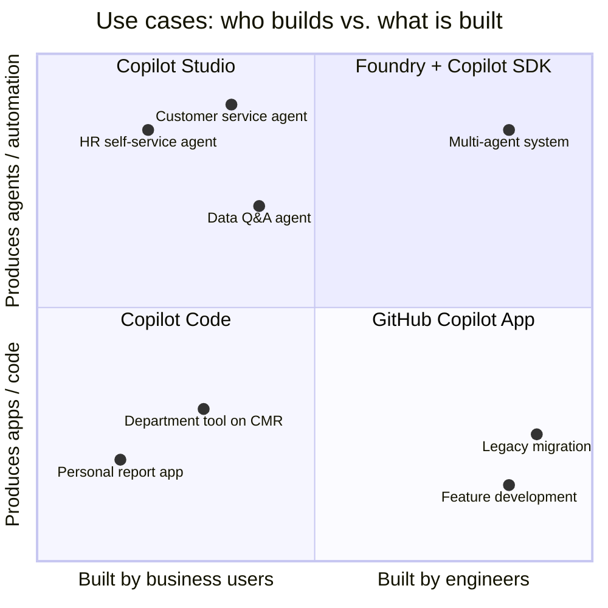

---

## 17. Decision tree

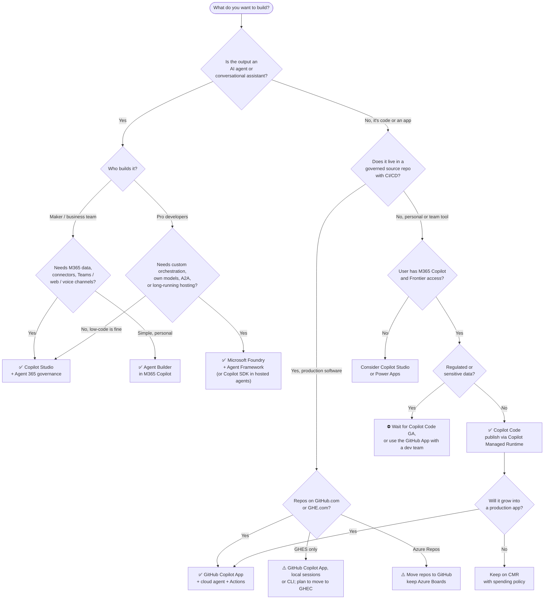

**Quick rules of thumb**

1. **"I'm an engineer shipping software"** → GitHub Copilot App.
2. **"I need an agent that talks to employees or customers"** → Copilot Studio.
3. **"I need a custom, code-first agent system"** → Foundry + Agent Framework (or the Copilot SDK).
4. **"I'm a business user who wants a working tool now"** → Copilot Code (pilot), hosted on Copilot Managed Runtime.
5. **"It's becoming important"** → move it to GitHub with rulesets and CI/CD, whatever tool started it.

---

## 18. Better-together reference architecture

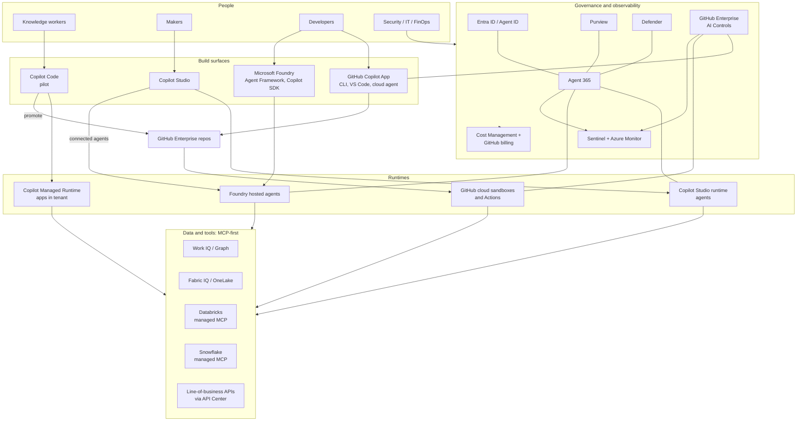

**Design principles 🔶**

1. **One repo platform:** GitHub Enterprise is the system of record for *all* code, including Studio solutions and promoted Copilot Code apps.
2. **One data-access pattern:** managed MCP endpoints with on-behalf-of identity, governed by the data platform (Unity Catalog, Snowflake RBAC, OneLake).
3. **One agent inventory:** Agent 365 for Microsoft agents, plus a joined GitHub audit feed in Sentinel. Revisit when Microsoft documents a native bridge.
4. **One telemetry standard:** OpenTelemetry GenAI conventions going to Azure Monitor, with the GitHub audit stream and metrics API in the same lake.
5. **Two FinOps ledgers, one report:** Copilot Credits (Azure Cost Management) and GitHub AI Credits (GitHub billing), merged in Power BI.

---

## 19. FinOps: worked cost scenarios

> These scenarios use list prices and **illustrative usage assumptions** 🔶. Replace the assumptions with your own telemetry after a pilot.

### Scenario A: 100 developers on GitHub Copilot Enterprise

| Line item | Calculation | Monthly |
|---|---|---|
| Copilot Enterprise seats | 100 × $39 | $3,900 (includes 390,000 pooled AI credits) |
| Agent-heavy usage (assumed) | 550,000 credits used − 390,000 included = 160,000 × $0.01 | $1,600 overage |
| Cloud sandboxes (assumed) | 2,000 sessions × 20 min × 4 vCPU / 16 GiB → 9.6M vCPU-s × $0.000024 + 38.4M GiB-s × $0.000003 | about $346 (before the Actions allowance) |
| GitHub Enterprise Cloud | 100 × about $21 🔶 | about $2,100 |
| **Total** | | **about $7,946** |

**Insights:**
- Because Enterprise seats include **credits worth exactly the seat price** ($39 = 3,900 credits), heavy users cost the same under seats or under fully metered **"Copilot access"** ($0 seat for GitHub Enterprise users). **Light users are cheaper on Copilot access**, because there's no unused prepaid credit.
- You **can't mix** the two models, so choose per enterprise based on how usage is spread across users.
- Set a **budget with a stop**: overage is on by default.

### Scenario B: Copilot Studio HR agent for 10,000 conversations per month

| Variant | Credits per conversation | Monthly credits | PAYG ($0.01) | Capacity packs ($200 per 25K) |
|---|---|---|---|---|
| B1: 3 generative answers (2) + 2 actions (5) | 16 | 160,000 | $1,600 | 7 packs = $1,400 |
| B2: B1 + 1 tenant-graph grounding (10) | 26 | 260,000 | $2,600 | 11 packs = $2,200 |
| B3: B2, but every user has an M365 Copilot licence (actions and grounding covered) | 6 | 60,000 | $600 | 3 packs = $600 |
| B4: B1, but using a premium model (about 200 credits per turn, 3 turns) | about 610 | about 6.1M | **about $61,000** | 244 packs = $48,800 |

**Insights:**
- **Model choice affects cost far more than anything else.** The same agent can cost about 40× more on a premium reasoning model.
- Use premium models only for the nodes that need them, and set **per-agent monthly limits**.
- Pre-buy with **P3** (up to 20% off) once usage is stable.

### Scenario C: Copilot Code pilot for 200 knowledge workers

| Line item | Calculation | Monthly |
|---|---|---|
| M365 Copilot licences | 200 × $30 (often already owned) | $6,000 |
| Copilot Credits | **No rate card.** Cap with a spending policy, for example $20 per user | at most $4,000 |
| Copilot Managed Runtime | Separate spending policy; no rate card | Cap explicitly ❓ |
| **Total exposure** | | **up to about $10,000** (about $4,000 incremental) |

**Insight:** with no rate card, a **hard spending-policy cap and per-user budgets** are the only way to control cost during the pilot. Measure credits per app built to set a baseline.

### Scenario D: governance overlay for 1,000 users

| Option | Monthly |
|---|---|
| Agent 365 standalone | 1,000 × $15 = $15,000 |
| M365 E7 (if moving from E5 + Copilot) | $99 per user, compared with roughly $57 E5 + $30 Copilot + Entra Suite + Agent 365 bought separately 🔶 |
| Minimum for observability | **At least one** Agent 365 or E7 licence assigned, otherwise telemetry is dropped |

---

## 20. Adoption roadmap and recommendations

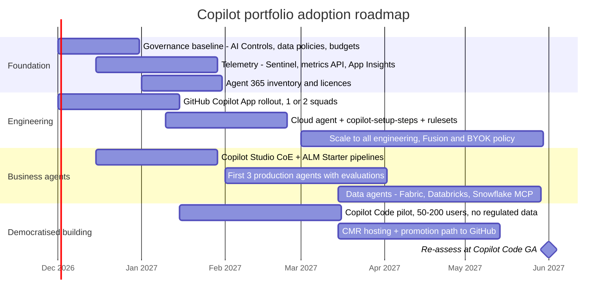

### Phase 1: first 90 days, foundation

1. **Governance first:**
   - GitHub Enterprise AI Controls, model and MCP policies, rulesets.
   - Power Platform data policies and Managed Environments.
   - Spending policies and budgets on **both** billing planes.
2. **Engineering pilot:** run the GitHub Copilot App and cloud agent with 1 or 2 squads. Measure merge rate and credits per merged PR.
3. **Studio CoE:** deploy Copilot ALM Starter, define environment strategy, set per-agent credit limits.
4. **Telemetry:** turn on audit streaming to Sentinel and the metrics API export.

### Phase 2: 3 to 6 months, scale

1. Roll the GitHub App out to all engineering. Standardise `copilot-setup-steps.yml`, custom agents and skills in `.github-private`.
2. Ship 3 to 5 production Studio agents, with evaluations as CI gates and Agent 365 registration.
3. Start the **Copilot Code pilot** with a limited group: local execution off, GitHub connection to GHE only, CMR as the only hosting path.
4. Build the **MCP catalogue** in Azure API Center, used by GitHub's MCP registry and Studio.

### Phase 3: 6 to 12 months, optimise

1. Move to P3 / pre-purchase based on observed usage. Review the choice between GitHub seats and Copilot access.
2. Add Foundry hosted agents for code-first and multi-agent workloads, including **Copilot SDK** agents.
3. Decide whether to expand Copilot Code once it is GA, with a rate card, RAI card and Purview coverage.
4. Merge FinOps reporting across Copilot Credits and GitHub AI Credits.

---

## 21. Risks, limitations and open questions

| # | Risk or open question | Product | Impact | Mitigation |
|---|---|---|---|---|
| 1 | No published rate card for Copilot Code and CMR | Code | High: cost surprises | Hard spending-policy caps; measure during the pilot |
| 2 | Code projects share folders without prompting | Code | High: data leakage between projects | Use dedicated folders; no sensitive data; wait for a fix |
| 3 | RAI card 404; Purview, EU Data Boundary and DLP coverage not documented | Code | High for regulated industries | Exclude regulated data until GA |
| 4 | GitHub agents not visible in Agent 365 / Entra Agent ID ❓ | GitHub | Medium: split inventory | Join GitHub audit and Agent 365 data in Sentinel |
| 5 | GitHub overage on by default; sandbox compute billed separately | GitHub | Medium: budget overrun | Budgets with a stop; alerts at 75/90/100% |
| 6 | Premium model cost (141–461 credits per turn) | Studio | High: 40× cost variance | Model policy per node; per-agent limits |
| 7 | 125% block on prepaid capacity can interrupt production agents | Studio | Medium: outage | PAYG overflow, or monitor allocations |
| 8 | Agent firewall doesn't cover MCP servers or setup steps, and can be bypassed | GitHub | Medium: exfiltration path | MCP allowlist; self-hosted runners with egress control |
| 9 | Anthropic models in Studio may process data outside the geography; not in GCC | Studio | Medium: compliance | Tenant opt-in only after a DPIA |
| 10 | GHES: no hosted Copilot, no cloud sessions | GitHub | Medium for on-prem customers | Plan a move to GHEC or GHE.com |
| 11 | Studio's "GitHub Copilot harness" renamed to "Microsoft Copilot harness"; no public evidence of the shared runtime 🟡 | Studio / GitHub | Low: messaging confusion | Treat as a separate product for governance |
| 12 | OTel GenAI semantic conventions still at "Development" status upstream | All | Low: schema churn | Pin exporter versions |
| 13 | Third-party news sources used for some items (GHES App GA, Agent 365 pricing details) 🟡 | — | Low | Confirm with Microsoft / GitHub account teams |
| 14 | Ignite 2026 (17–20 Nov) announcements aren't included | All | Medium: may be out of date soon | Refresh this document after Ignite |

---

## 22. What to watch (Ignite 2026 and beyond)

- **Copilot Code:**
  - GA date, a **published rate card**, RAI card, Purview and EU Data Boundary coverage.
  - Better folder isolation between projects.
  - BYOK.
- **Copilot Managed Runtime:** GA, pricing, SLA, more languages beyond TypeScript/JavaScript, agent hosting.
- **Microsoft Copilot SDK (v2):** the rebrand from the GitHub Copilot SDK, Entra sign-in, and whether **one harness** becomes official across Studio, Code and GitHub.
- **Agent 365 ↔ GitHub:** whether GitHub cloud-agent sessions appear in the Agent 365 registry or get Entra Agent IDs.
- **GitHub "Copilot access" licensing:** adoption, and whether it can be mixed with seats in the future.
- **Copilot Fusion:** pricing and quality benchmarks against single-model sessions.
- **Studio:** a GA date for the Copilot harness, Studio Apps, and Defender real-time protection.
- **Data platforms:** GA of Databricks Genie MCP and Snowflake managed MCP with dynamic client registration.
- **Observability:** OTel GenAI conventions reaching stable status; Agent 365 financial observability.

---

## 23. Glossary

| Term | Meaning |
|---|---|
| **A2A** | Agent-to-Agent protocol for agents to call other agents |
| **Agent 365** | Microsoft's control plane for registering, governing, securing and observing agents |
| **Agent HQ** | GitHub's surface for running third-party agents (for example Claude, Codex) in GitHub |
| **AI Controls** | GitHub Enterprise's agent control plane: policies, audit, MCP registry |
| **BYOK** | Bring your own key: use your own model-provider account with GitHub Copilot |
| **CCCU** | Copilot Credit Commit Unit, used in the P3 pre-purchase plan |
| **CMR** | Copilot Managed Runtime: in-tenant hosting for apps built with Copilot |
| **Copilot Credits** | Microsoft's consumption currency for Copilot Studio and Copilot Code (about $0.01) |
| **Copilot Fusion** | GitHub's multi-model orchestration: Standard, High, Max, Fast |
| **Copilot harness** | The agent loop: planning, tools, context, memory, sandbox. Shared across the GitHub Copilot surfaces and exposed through the Copilot SDK |
| **Copilot SDK** | Library that embeds the Copilot harness in your own apps (v2: Microsoft Copilot SDK) |
| **EMU** | Enterprise Managed Users: GitHub accounts managed by your identity provider |
| **Entra Agent ID** | Microsoft Entra identity type for agents |
| **GHEC / GHE.com / GHES** | GitHub Enterprise Cloud / GHEC with data residency / GitHub Enterprise Server |
| **GitHub AI Credits** | GitHub's consumption currency ($0.01), which replaced premium requests on 1 Jun 2026 |
| **MCP** | Model Context Protocol: an open standard for exposing tools and data to agents |
| **MXC** | Microsoft's local sandboxing technology used for local agent execution |
| **P3** | Pre-Purchase Plan for Copilot Credits (1-year commitment, up to 20% off) |
| **PAYG** | Pay-as-you-go billing through an Azure subscription |
| **PPAC** | Power Platform admin center |
| **Work IQ / Fabric IQ / Foundry IQ** | Microsoft's grounding layers for work data, analytics data and enterprise knowledge |

---

## 24. Sources

Research was done in Nov 2026. Items marked 🟡 or ❓ in the body rely on partial, secondary or missing sources.

**Copilot Code and Copilot Managed Runtime**
- [Copilot Code overview](https://learn.microsoft.com/en-us/copilot/code/overview) · [Get started](https://learn.microsoft.com/en-us/copilot/code/get-started) · [Use Code](https://learn.microsoft.com/en-us/copilot/code/use-code) · [Requirements](https://learn.microsoft.com/en-us/copilot/code/code-requirements) · [Admin](https://learn.microsoft.com/en-us/copilot/code/code-admin) · [GitHub connection](https://learn.microsoft.com/en-us/copilot/code/code-github) · [FAQ](https://learn.microsoft.com/en-us/copilot/code/code-faq)
- [Copilot Code: make the power of coding accessible to everyone](https://techcommunity.microsoft.com/blog/microsoft-copilot-blog/copilot-code-make-the-power-of-coding-accessible-to-everyone/4562358)
- [Copilot Managed Runtime documentation](https://learn.microsoft.com/en-us/microsoft-365/copilot-managed-runtime/?view=o365-worldwide) · [Architecture](https://learn.microsoft.com/en-us/microsoft-365/copilot-managed-runtime/developer/apps/architecture?view=o365-worldwide)
- [Microsoft hosts and manages the code created by Copilot](https://www.microsoft.com/en-us/copilot/blog/copilot-studio/build-where-you-want-run-with-confidence-now-microsoft-hosts-and-manages-the-code-created-by-copilot/)
- [Usage-based billing with Copilot Credits](https://learn.microsoft.com/en-us/copilot/plan/usage-based-billing-overview-copilot-credits) · [Evolution of the Copilot pricing model](https://techcommunity.microsoft.com/blog/microsoft-copilot-blog/evolution-of-the-copilot-pricing-model/4559416) · [Copilot Credits guide (PDF)](https://cdn-dynmedia-1.microsoft.com/is/content/microsoftcorp/microsoft/bade/documents/products-and-services/en-us/ai/CopilotCreditsGuide.pdf)
- [Frontier program](https://adoption.microsoft.com/copilot/frontier-program/) · [Plugins at Microsoft Ignite 2026](https://techcommunity.microsoft.com/blog/microsoft-copilot-blog/plugins-at-microsoft-ignite-2026/4569951)

**Copilot Studio**
- [Billing and credit overview](https://learn.microsoft.com/en-us/microsoft-copilot-studio/agents-experience/billing-credit-overview) · [Copilot Studio pricing](https://www.microsoft.com/en-us/microsoft-365-copilot/pricing/copilot-studio) · [Azure pricing](https://azure.microsoft.com/en-us/pricing/details/copilot-studio/) · [Copilot Credit P3](https://learn.microsoft.com/en-us/azure/cost-management-billing/reservations/copilot-credit-p3)
- [Govern credit consumption](https://learn.microsoft.com/en-us/microsoft-copilot-studio/guidance/govern-credit-consumption) · [Manage Microsoft Copilot harness usage](https://learn.microsoft.com/en-us/power-platform/admin/manage-usage-microsoft-copilot-harness)
- [What's new](https://learn.microsoft.com/en-us/microsoft-copilot-studio/whats-new) · [Copilot harness, agent skills and richer context](https://www.microsoft.com/en-us/copilot/blog/copilot-studio/new-and-improved-github-copilot-harness-agent-skills-and-richer-context/) · [Computer-using agents, workflows, voice](https://www.microsoft.com/en-us/copilot/blog/copilot-studio/new-and-improved-computer-using-agents-a-new-workflows-experience-and-real-time-voice-experiences/)
- [Security and governance](https://learn.microsoft.com/en-us/microsoft-copilot-studio/security-and-governance) · [Data loss prevention](https://learn.microsoft.com/en-us/microsoft-copilot-studio/admin-data-loss-prevention) · [Entra agent identities](https://learn.microsoft.com/en-us/microsoft-copilot-studio/admin-use-entra-agent-identities) · [External security provider](https://learn.microsoft.com/en-us/microsoft-copilot-studio/external-security-provider)
- [ALM guidance](https://learn.microsoft.com/en-us/microsoft-copilot-studio/guidance/alm) · [GitHub Actions for Power Platform](https://learn.microsoft.com/en-us/power-platform/alm/tutorials/github-actions-deploy) · [Copilot ALM Starter](https://github.com/microsoft/copilot-alm-starter) · [MCS labs: pipelines and source control](https://microsoft.github.io/mcs-labs/labs/pipelines-and-source-control/)

**GitHub Copilot App, harness and SDK**
- [GitHub Copilot App (docs)](https://docs.github.com/en/copilot/concepts/agents/github-copilot-app) · [GA announcement](https://github.blog/changelog/2026-06-17-github-copilot-app-generally-available/) · [Universe releases](https://github.blog/changelog/2026-10-28-github-copilot-app-universe-releases/) · [The agent-native desktop experience](https://github.blog/news-insights/product-news/github-copilot-app-the-agent-native-desktop-experience/)
- [GitHub Universe 2026: evolving every layer of the stack](https://github.blog/news-insights/company-news/github-universe-2026-evolving-every-layer-of-the-stack/) · [Pick your agent: Claude and Codex on Agent HQ](https://github.blog/news-insights/company-news/pick-your-agent-use-claude-and-codex-on-agent-hq/)
- [Usage-based billing](https://docs.github.com/copilot/concepts/billing/usage-based-billing-for-organizations-and-enterprises) · [Billing and plan updates (1 Jun 2026)](https://github.blog/changelog/2026-06-01-updates-to-github-copilot-billing-and-plans/) · [GitHub Enterprise now includes Copilot access](https://github.blog/changelog/2026-10-28-github-enterprise-now-includes-access-to-github-copilot/) · [Plans](https://github.com/features/copilot/plans)
- [Cloud and local sandboxes](https://github.com/github/docs/blob/main/content/copilot/concepts/security-governance-and-network-settings/about-cloud-and-local-sandboxes.md) · [Sandbox billing](https://github.com/github/docs/blob/main/content/billing/concepts/product-billing/cloud-and-local-sandboxes.md) · [Customize the agent environment](https://docs.github.com/copilot/how-tos/copilot-on-github/customize-copilot/customize-cloud-agent/customize-the-agent-environment) · [Agent firewall](https://docs.github.com/copilot/how-tos/copilot-on-github/customize-copilot/customize-cloud-agent/customize-the-agent-firewall) · [Risks and mitigations](https://docs.github.com/copilot/concepts/agents/cloud-agent/risks-and-mitigations)
- [GitHub Copilot SDK](https://github.com/github/copilot-sdk) · [Agent loop](https://github.com/github/copilot-sdk/blob/main/docs/features/agent-loop.md) · [Microsoft Copilot SDK v2 breaking changes](https://github.com/microsoft/copilot-sdk/blob/main/docs/v2-breaking-changes.md) · [MXC](https://github.com/microsoft/mxc)

**Governance, monitoring and GitHub Enterprise**
- [Enterprise AI Controls GA](https://github.blog/changelog/2026-02-26-enterprise-ai-controls-agent-control-plane-now-generally-available/) · [Configure MCP server access](https://docs.github.com/en/enterprise-cloud@latest/copilot/how-tos/administer-copilot/manage-mcp-usage/configure-mcp-server-access)
- [Copilot usage metrics API](https://docs.github.com/en/rest/copilot/copilot-usage-metrics) · [Metrics GA](https://github.blog/changelog/2026-02-27-copilot-metrics-is-now-generally-available/) · [BYOK in the usage API](https://github.blog/changelog/2026-11-03-byok-and-enterprise-custom-models-in-the-copilot-usage-api/) · [Agent session streaming](https://github.blog/changelog/2026-07-02-copilot-agent-session-streaming-is-now-in-public-preview/)
- [Copilot with data residency](https://docs.github.com/en/enterprise-cloud@latest/admin/data-residency/github-copilot-with-data-residency) · [Data residency and FedRAMP](https://github.blog/changelog/2026-04-13-copilot-data-residency-in-us-eu-and-fedramp-compliance-now-available/) · [Copilot on GHES](https://docs.github.com/en/enterprise-server@latest/copilot/copilot-on-ghes/about-copilot-on-ghes)
- [Cloud agent with Azure Boards](https://docs.github.com/en/enterprise-cloud@latest/copilot/how-tos/copilot-integrations/integrate-cloud-agent-with-azure-boards) · [GitHub Copilot for Azure Boards](https://devblogs.microsoft.com/devops/github-copilot-for-azure-boards/)
- [Defender AI agent runtime protection](https://learn.microsoft.com/en-us/defender-endpoint/ai-agent-runtime-protection-overview) · [Defender real-time protection for agents](https://learn.microsoft.com/en-us/defender-xdr/security-for-ai/ai-agent-real-time-protection) · [Purview DSPM for AI](https://learn.microsoft.com/en-us/purview/dspm-for-ai)

**Agent 365, Foundry and data platforms**
- [Microsoft Agent 365](https://www.microsoft.com/en-us/microsoft-agent-365) · [M365 E7 and Agent 365 GA](https://techcommunity.microsoft.com/blog/microsoft_365blog/microsoft-365-e7-and-agent-365-are-now-generally-available/4516295) · [Agent 365 at Ignite 2026](https://techcommunity.microsoft.com/blog/agent-365-blog/microsoft-ignite-2026-your-guide-to-agent-365/4571750) · [Agent 365 security](https://learn.microsoft.com/en-us/security/security-for-ai/agent-365-security) · [Agent 365 developer: get started](https://learn.microsoft.com/en-us/microsoft-agent-365/developer/get-started)
- [Entra Agent ID](https://learn.microsoft.com/en-us/entra/agent-id/agent-identities) · [Agent registry convergence](https://learn.microsoft.com/en-us/entra/agent-id/agent-registry-convergence)
- [Foundry Agent Service overview](https://learn.microsoft.com/en-us/azure/foundry/agents/overview) · [Hosted agents](https://learn.microsoft.com/en-us/azure/foundry/agents/concepts/hosted-agents) · [Foundry Control Plane](https://learn.microsoft.com/en-us/azure/foundry/control-plane/overview) · [Foundry and Agent 365](https://learn.microsoft.com/en-us/azure/foundry/agents/concepts/agent-365-integration) · [Tracing](https://learn.microsoft.com/en-us/azure/foundry/observability/concepts/trace-agent-concept) · [Agent Service pricing](https://azure.microsoft.com/en-us/pricing/details/foundry-agent-service/)
- [Microsoft Agent Framework 1.0](https://devblogs.microsoft.com/agent-framework/microsoft-agent-framework-version-1-0/) · [Agents with the GitHub Copilot SDK and Agent Framework](https://devblogs.microsoft.com/semantic-kernel/build-ai-agents-with-github-copilot-sdk-and-microsoft-agent-framework/)
- [Databricks Genie with Copilot Studio and Foundry](https://techcommunity.microsoft.com/blog/azure-databricks/azure-databricks-genie-integration-with-copilot-studio-and-microsoft-foundry-is-/4471087) · [Databricks managed MCP](https://learn.microsoft.com/en-au/azure/databricks/agents/mcp-tools/managed-mcp) · [Databricks and M365 Copilot](https://learn.microsoft.com/en-us/azure/databricks/integrations/msft-m365-copilot) · [Unity AI Gateway GA](https://www.databricks.com/blog/unity-ai-gateway-generally-available)
- [Snowflake Cortex Agents in Teams GA](https://docs.snowflake.com/en/release-notes/2025/other/2025-11-05-cortex-agents-teams-ga) · [Cortex Agents MCP](https://docs.snowflake.com/en/user-guide/snowflake-cortex/cortex-agents-mcp) · [Snowflake MCP in Copilot Studio](https://microsoft.github.io/mcscatblog/posts/snowflake-mcp-copilot-studio/)
- [Fabric data agents in Copilot Studio GA](https://community.fabric.microsoft.com/blog/fbc_fabricupdatesblogs/fabric-data-agents-in-microsoft-copilot-studio-generally-available/5362882) · [Foundry IQ in Copilot Studio](https://techcommunity.microsoft.com/blog/azure-ai-foundry-blog/foundry-iq-is-now-in-copilot-studio-bring-your-enterprise-data-to-every-agent-co/4534635)

**Secondary sources** (used for the 🟡 items): [heise.de on the GitHub Copilot App](https://www.heise.de/en/news/New-GitHub-Copilot-App-Aims-to-Tame-Chaos-in-Agent-Driven-Development-11318184.html) · [Microsoft TechWiese: Universe 2026](https://www.microsoft.com/de-de/techwiese/news/github-universe-2026-copilot-app-multi-model-orchestrierung-und-neues-lizenzmodell.aspx) · [GHES support for the GitHub Copilot App](https://casrai.org/news/github-copilot-app-enterprise-server-support-2026) · [Agent 365 pricing analysis](https://www.kesslernity.com/blog/agent-365-pricing) · [Message center MC1519871](https://mc.merill.net/message/MC1519871)

---

*Prepared Nov 2026 by Copilot in Code, with parallel research agents. Please re-check prices and preview features with Microsoft and GitHub before making purchasing decisions.*
